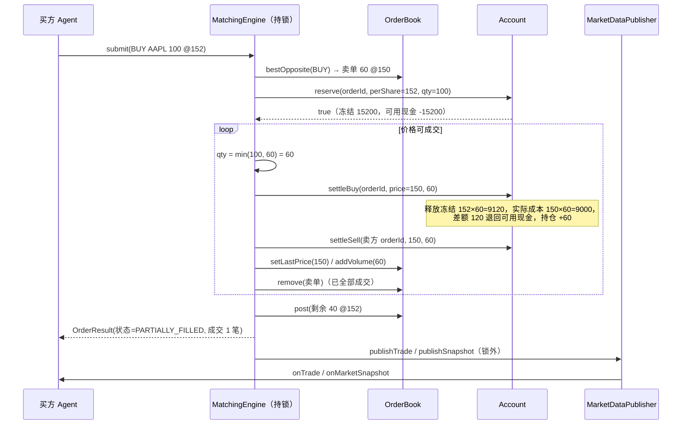
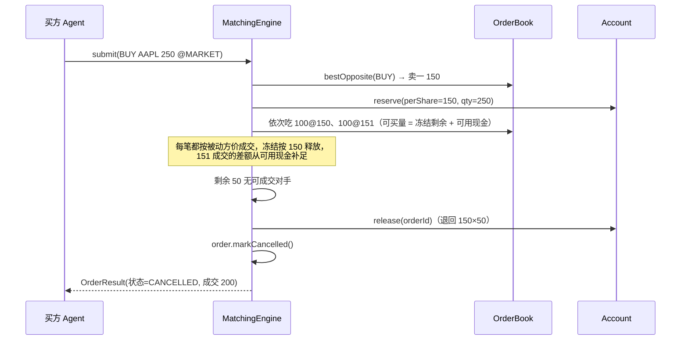
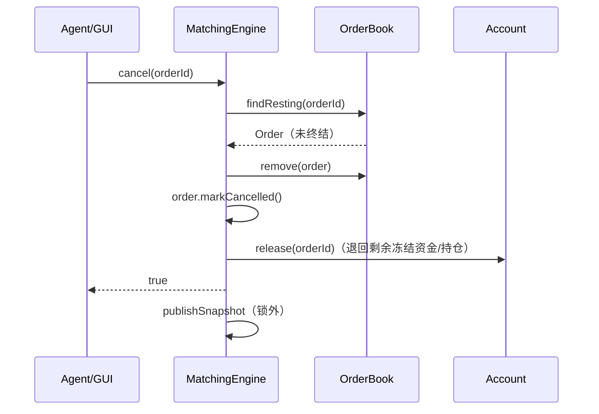
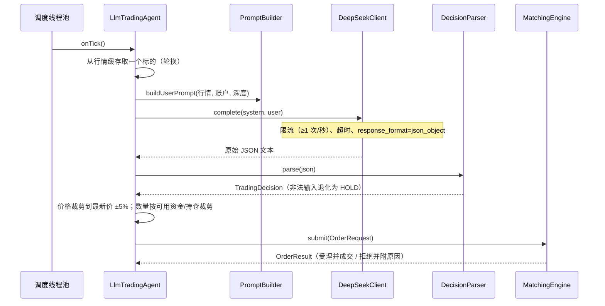
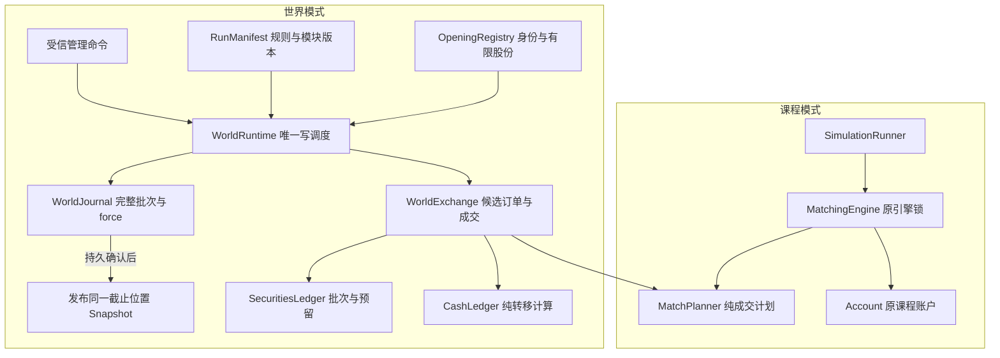
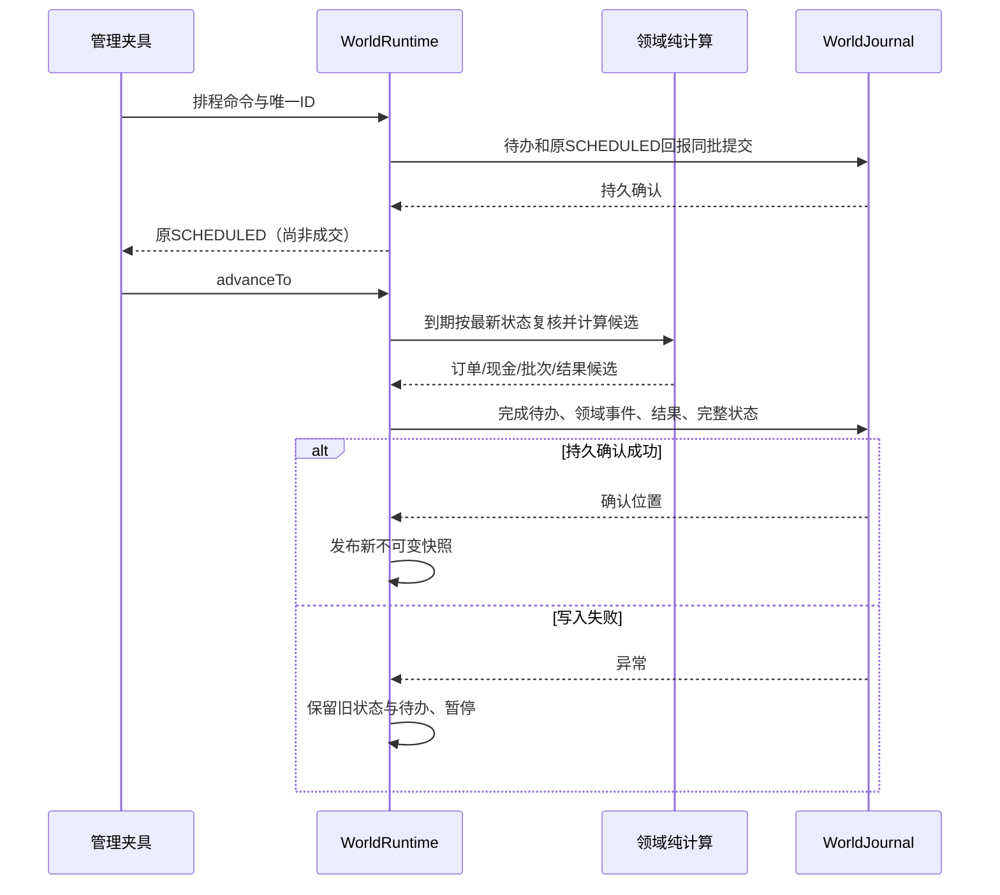
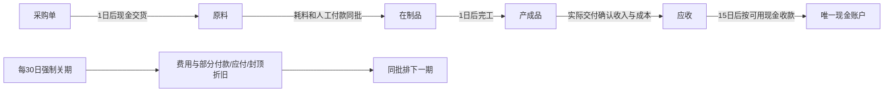
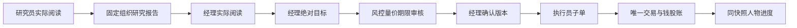

# 02 系统架构设计

> 第1–5节保留课程系统说明；第6节描述已本地验收的世界时间/现金/证券/可靠撮合子集。扩展语义见[总体设计基线](design/总体设计基线.md)，实施状态见[总 Plan](superpowers/plans/2026-11-06-world-implementation.md)。不能根据类图推定公司、银行、媒体、角色或记忆模块已经完整实现。

## 1. 分层与包结构

```
gui / app            表现层：JavaFX 界面、控制台演示
  └─ sim             装配层：SimulationRunner 组装引擎/账户/agent/定时器，驱动交易周期
       └─ engine     业务层：MatchingEngine（撮合）、OrderBook（订单簿）
          ├─ account 业务层：Account / AccountManager / PerformanceTracker
          ├─ market  业务层：MarketDataPublisher / MarketDataListener（行情广播）
          └─ agent   业务层：TradingAgent 及实现（人类、AI/LLM、噪音做市）
               └─ io / config / model   数据层：CSV 落盘、配置加载、不可变领域对象
```

依赖方向单向向下：`gui/app → sim → engine|account|market|agent → model`。
agent 只依赖 `OrderGateway` 接口，不接触引擎内部结构，便于替换与测试。

## 2. 类图

```mermaid
classDiagram
    class OrderGateway {
        <<interface>>
        +submit(OrderRequest) OrderResult
        +cancel(long) boolean
    }
    class MatchingEngine {
        -Object lock
        -Map~String,OrderBook~ books
        -AccountManager accounts
        -MarketDataPublisher publisher
        -AtomicLong orderIdSeq
        +submit(OrderRequest) OrderResult
        +cancel(long) boolean
        +closeMarket() int
        +snapshot(String,int) OrderBookSnapshot
        +marketSnapshot(String,int) MarketSnapshot
    }
    class OrderBook {
        -NavigableMap~BigDecimal,Deque~ bids
        -NavigableMap~BigDecimal,Deque~ asks
        -Map~Long,Order~ restingOrders
        -BigDecimal lastPrice
        +post(Order)
        +bestOpposite(Side) Order
        +remove(Order)
        +snapshot(int) OrderBookSnapshot
    }
    class AccountManager {
        -Map~String,Account~ accounts
        +createAccount(String,String,BigDecimal) Account
        +ranking(Map) List~PerformanceRank~
        +markAllEquity(Map)
    }
    class Account {
        -BigDecimal cash
        -BigDecimal frozenCash
        -Map~String,Position~ positions
        -Map~Long,Reservation~ reservations
        +reserve(long,String,Side,BigDecimal,long) boolean
        +settleBuy(long,String,BigDecimal,long)
        +settleSell(long,String,BigDecimal,long) BigDecimal
        +release(long)
        +equity(Map) BigDecimal
        +returnRate(Map) BigDecimal
        +seedPosition(String,long,BigDecimal)
    }
    class Position {
        -long quantity
        -long frozenQuantity
        -BigDecimal averageCost
        +addShares(long,BigDecimal)
        +removeShares(long,BigDecimal) BigDecimal
    }
    class MarketDataPublisher {
        -List~MarketDataListener~ listeners
        +subscribe(MarketDataListener)
        +publishTrade(Trade)
        +publishSnapshot(MarketSnapshot)
    }
    class TradingAgent {
        <<interface>>
        +onMarketSnapshot(MarketSnapshot)
        +onTick()
    }
    class AbstractTradingAgent {
        <<abstract>>
        #OrderGateway gateway
        #Account account
        +submit(OrderRequest) OrderResult
    }
    class HumanBrokerAgent
    class NoiseAgent
    class MomentumAgent
    class LlmTradingAgent {
        -LlmClient client
        -BigDecimal priceBandPercent
    }
    class LlmClient {
        <<interface>>
        +complete(String,String) String
    }
    class DeepSeekClient
    class DecisionParser {
        <<utility>>
        +parse(String) TradingDecision
    }
    class CsvHistoryRecorder {
        +onOrderAccepted(Order,List)
        +onTrade(Trade)
        +writeRanking(List)
    }
    class SimulationRunner {
        +start()
        +closeAndRank() List~PerformanceRank~
    }

    OrderGateway <|.. MatchingEngine
    MatchingEngine o-- OrderBook
    MatchingEngine --> AccountManager
    MatchingEngine --> MarketDataPublisher
    AccountManager o-- Account
    Account o-- Position
    MarketDataPublisher o-- MarketDataListener
    MarketDataListener <|.. AbstractTradingAgent
    TradingAgent <|.. AbstractTradingAgent
    AbstractTradingAgent <|-- HumanBrokerAgent
    AbstractTradingAgent <|-- NoiseAgent
    AbstractTradingAgent <|-- MomentumAgent
    AbstractTradingAgent <|-- LlmTradingAgent
    LlmTradingAgent --> LlmClient
    LlmClient <|.. DeepSeekClient
    LlmTradingAgent --> DecisionParser
    MarketDataListener <|.. CsvHistoryRecorder
    SimulationRunner --> MatchingEngine
    SimulationRunner --> AccountManager
    SimulationRunner --> MarketDataPublisher
```



## 3. 时序图

### 3.1 限价买单与挂单卖单成交（含部分成交与价格改善）



### 3.2 市价单扫簿与剩余撤销



### 3.3 撤单



### 3.4 LLM 决策周期



## 4. 线程模型（对应规格 4.4）

| 线程 | 职责 | 说明 |
| --- | --- | --- |
| 主线程 | 装配 `SimulationRunner`、启动 GUI | 不参与撮合 |
| 调度线程池（`ScheduledExecutorService`） | 按各自间隔调用 `agent.onTick()` | agent 真并发，直接冲击引擎的线程安全设计 |
| 权益标记任务 | 每秒 `AccountManager#markAllEquity` | 维护最大回撤曲线 |
| JavaFX 线程 | 渲染与交互 | 行情回调里只做 `Platform.runLater` |
| 收尾 | `closeAndRank`：停调度 → 收盘撤单 → 排行榜落盘 | 顺序固定，避免收盘后仍有下单 |

### 锁与并发约定

1. **单锁撮合**：校验、冻结、撮合、记账、改簿全在 `MatchingEngine.lock` 内完成，
   等价于规格要求的 “`submitOrder()` 必须 synchronized”，保证状态变更串行化。
2. **锁顺序固定**：引擎锁 → 账户锁。账户层不回调引擎，因此不存在反向加锁，不会死锁。
3. **锁外副作用**：行情广播、CSV 落盘在锁外执行，监听者慢 I/O 不会拖住撮合；
   监听者抛异常只计数不中断撮合（`MarketDataPublisher#getListenerErrorCount`）。
4. **每次决策只处理一个标的**：AI agent 每 tick 只对一个标的调一次 LLM，控制额度与并发。

## 5. 关键不变量（测试覆盖）

| 不变量 | 覆盖测试 |
| --- | --- |
| 成交价取被动方价格，买方获得价格改善 | `matchesAtRestingPrice` |
| 同价按时间优先、不同价按价格优先 | `samePriceRespectsTimePriority`、`betterPriceTakesPrecedence` |
| 撮合后订单簿不交叉（bestBid < bestAsk） | `concurrentSubmissionsKeepInvariants` |
| 资金守恒：现金 + 成本基础 = 期初 + 已实现盈亏 | `cashAndCostBasisAreConserved`、`concurrentSubmissionsKeepInvariants` |
| 撤单/收盘后冻结全部释放、可用现金恢复 | `cancelReleasesFrozenCash`、`closedMarketRejectsOrders` |
| 资金/持仓不足被拒绝且无副作用 | `buyRejectedWhenInsufficientCash`、`sellRejectedWhenInsufficientShares` |
| 多标的互不干扰 | `multiSymbolBooksAreIsolated` |
| 并发下无重复订单号、金额不为负 | `concurrentSubmissionsKeepInvariants` |
| 收益率不把初始持仓误算为收益 | `seededHoldingsDoNotInflateReturnRate` |
| 端到端：真起线程产生成交并落盘 | `SimulationIntegrationTest` |

## 6. 已验收的世界运行与交易子集

本节对应M2.4b/187项标准验收（`docs/05` §12）。制造与董事会的施工不自动升级本节状态。两个入口共用MatchPlanner，账户权威和运行规则各自明确。



世界模式调用CashLedger的纯候选函数，不再创建并行现金账；不调用会先修改课程账户的旧submit。WorldScheduler定义四阶段/公平顺序；Runtime推进的是可序列化PendingTask，而非把Runnable闭包写入文件。新消息的投递阶段与动作完成阶段分开。



| 事实 | 唯一权威 / 派生口径 |
| --- | --- |
| 现金总余额 | WorldState.accounts中的CashAccount；冻结不是第二份现金 |
| 买方冻结 / 可用 | 活动买限价单的限价×剩余量；free=gross−冻结 |
| 持股 / 卖方冻结 | Lot.remaining含冻结；SellReservation分配是冻结唯一权威 |
| 可卖批次 | FLOAT且eligibleFromDay≤当前实验日，remaining再减预留 |
| 簿优先序 | 持久订单的price/sequence；不存可漂移的第二份队列 |
| 恢复源 | 唯一WorldJournal的完整确认批次；CSV用于课程展示/黑盒复算 |

原始Snapshot是管理视图；schema6的人物权限投影另见第9节。规则档案为模拟实验，不涵盖真实交易日历、费用、银行托管等全部制度；完整世界仍按总Plan推进。

## 7. 制造经营实验的账务与自动待办

`stock-company-experiment-v1`在上述交易子集上启用manufacturing:1和schema4。`ManufacturingModel`只做不可变候选计算；`ManufacturingRun`保存公司证券绑定、经营台账和管理结果，不保存第二份现金。公司账户的原始余额仍来自同一WorldState.accounts，客户付款须扣除其股票买单冻结。



每个领域转换与后续到货/完工/回款待办、结果、资金事件和完整世界状态一起持久确认。失败到货保留FAILED_NO_CASH而不增原料，失败回款保留OVERDUE而不减应收。重启读取已确认结果，不重跑付款。强制关期属于RULES，市场收盘不停止经营费用；固定费用现金不足也确认未付账单。

每批核对`现金 + 原料/WIP/成品成本 + 应收 + 设备净值 = 应付 + 初始权益 + 累计利润`及世界现金守恒。公司财产owner必须对应证券发行组织，经营账户唯一；首档案拒绝未建模的公司持股及第二账户，禁止普通转账/股票申报绕过经营分录。股价与市值不改变公司现金或账面权益。

本单元是无董事会、无角色工具的确定性管理实验。治理预算、分红、任职、媒体、银行和新观察界面按总Plan后续接入；未启用的能力不由模型文本补齐。

## 8. 治理预算与固定期间证据

`governed-stock-company-experiment-v1`在制造实验上显式启用governance:1、schema5并冻结五席章程。`BoardModel`计算会议、预算承诺及复盘候选，`BoardRun`保存治理回报和截止证据；预算不存资产，现金仍只有WorldState.accounts。

会议经历召集、材料冻结、表决、通过/拒绝、明确实施。普通事项需三票，预算新上限合计超过1000需四票，回避不降低法定人数三人。ADOPTED不自动授予预算；已实施上限才能支持新的采购和人工承诺。采购占用与订单/到货待办同批，实际付款后转已花，现金不足到货失败全额释放；跨期到货仍计原承诺期间。固定费用及COGS不重复占预算。

每次强制关期在同一批保留截止position、公司报告/合同/应收引用、实验指标，登记唯一复盘会议与下一毫秒的开会/复盘任务，并继续排下一关期。30日RULES证据早于同刻COMPLETION的到货，不从后来余额倒推。以后回款不会修改旧证据。无到期承诺的经营兑现标缺失；披露质量和长期投入尚无实现，总分为空并标INCOMPLETE。

该入口仍是受信管理实验：seatId为声明，不是远程登录认证；自动登记材料不代表人物读过。任职、实际阅读、四岗交易母任务、融资、分红与自主模型仍须后续接入。

## 9. 任职权限与资料阅读纯核

`RoleAccess`保存账户引用、明确PRODUCT管理授权和人物—组织—岗位—有效期，不保存余额或持仓。四岗共用同一个获授权产品账户；经理不能执行订单，研究员不能改经理目标，风控只具暂停权限判定，执行员不能改投资方向。任职区间左闭右开，撤销立即终止新访问而保留原任期及个人历史。

`validateAgainst`把还原的授权状态与冻结开局逐项对照：账户属主和全集、所有PERSON个人通道、PRODUCT种类/明确账户、人物与组织登记；不把雇主自有资产当基金产品，也不按组织通配账户。实际Runtime还须固定配置并保护任职历史，纯核ALLOW不代表引擎动作、交易母任务或风险配额已接入。

`InformationModel`仅追加固定文档版本，公开/组织/本人受众分别裁剪目录。目录没有正文和内部来源，开始阅读也不给全文。每人最多一个活动单；到期按最新任职历史在固定due时点复核，成功才产生本人固定版本经历。迟交不延长工时，due后离任不抹去已读，后来重新入职不倒填过去无权的阅读。取消/拒绝释放工时，新员工不会继承前任经历。

两个纯核在schema6的`informed-stock-company-experiment-v1`档案中接入WorldRuntime。`RoleRun`保存固定授权配置、任职状态与管理回报，`InformationRun`保存固定读者、原始资料、阅读活动及回报；现金和持仓仍取唯一世界账。开始阅读同批排唯一完成待办，取消/拒绝/完成只处理对应实例；同刻RULES撤销先于COMPLETION完成复核。旧schema1–5入口保持原档案和JSON形状。

`roleView(person)`从一个已确认Snapshot派生人物投影：本人当前任职、本人及明确获授权产品资产、公开市场、可见资料目录、本人活动阅读和已完成经历。裁去内部来源、全局阅读序号、他人账户、他人经历和全局提交位置；公开阅读引用明确绑定人物及本人阅读实例，避免隐藏活动泄露和取消误伤。普通现金转移、真实撮合、制造及关期也保留角色与信息状态。

这一层仍由可信管理者排程，权限枚举与可用能力说明尚未绑定网络身份或真实模型工具注册。目录不等于全文、管理会议材料不等于已读；六层认知、媒体自主发布、经理母任务/风控额度/交易员执行链仍按Plan实施。

## 10. 四岗任务纯核

`RoleTradingModel`在现有角色、资料和交易纯模块上保存研究元数据、目标版本、审核、暂停及真实订单链接。研究正文发表为InformationModel的固定组织文档，经理实际阅读后才能引用报告设目标。风控校验数量、价格与有效期，经理确认后进入执行阶段。

目标采用账户标的的绝对股数。额度从WorldExchange的实际filled和活动leaves派生，现金及持仓由原世界账提供。目标更新先进入UPDATING，旧挂单撤净后用最新实际持仓建立新版本基点，再次审核确认。旧成交已进入持仓，更新后按新差额执行，反向目标也采用此口径。

该纯核由下一节的schema7运行桥调用。组织研究报告阅读耗时采用该实验档案的一模拟分钟，来源资料仍使用各自固定版本的阅读耗时。

## 11. 人物会话与四岗交易运行

`role-trading-experiment-v1`通过八参构造启用十模块与schema7。`RoleTradingRun`保存工作流及人物命令回报，订单、成交、冻结、现金和持仓继续来自同一WorldExchange与证券账。目标是账户标的的绝对股数，普通交易先于目标或穿插更新时，基点同样取该版本创建批次的实际持仓。



可信宿主打开`WorldRoleSession`时固定人物与全部组织任职映射。动作只接收业务DTO，到期复核原任职。人物实时观察用该映射与当前有效任职的交集，复用原RoleView投影裁剪资产、目录与权限。个人资产和实际完成经历继续可见，无任职人物仍可阅读公开或本人直投资料。组织阅读完成时从原命令取回观察任职，重新任职须重新开始获权阅读。

主动暂停、目标更新和取消先关闭新子单入口，下一模拟毫秒真实撤单，期间合法成交进入原账。目标及风险期限、任职结束在到期RULES中处理活动单。撤净后更新目标建立新持仓基点并重新审核确认，各版本和审核有独立定时任务，内部标识采用找空闲策略。

工作流、原请求、回报、实际订单和后续待办随一个WorldJournal批次确认。恢复核对历史前缀、原命令归属、目标与风险输入、创建时真实持仓、已读来源及订单字段。该档案的模型配置为none，决定屏障、尝试恢复和预算见M4d施工单。
