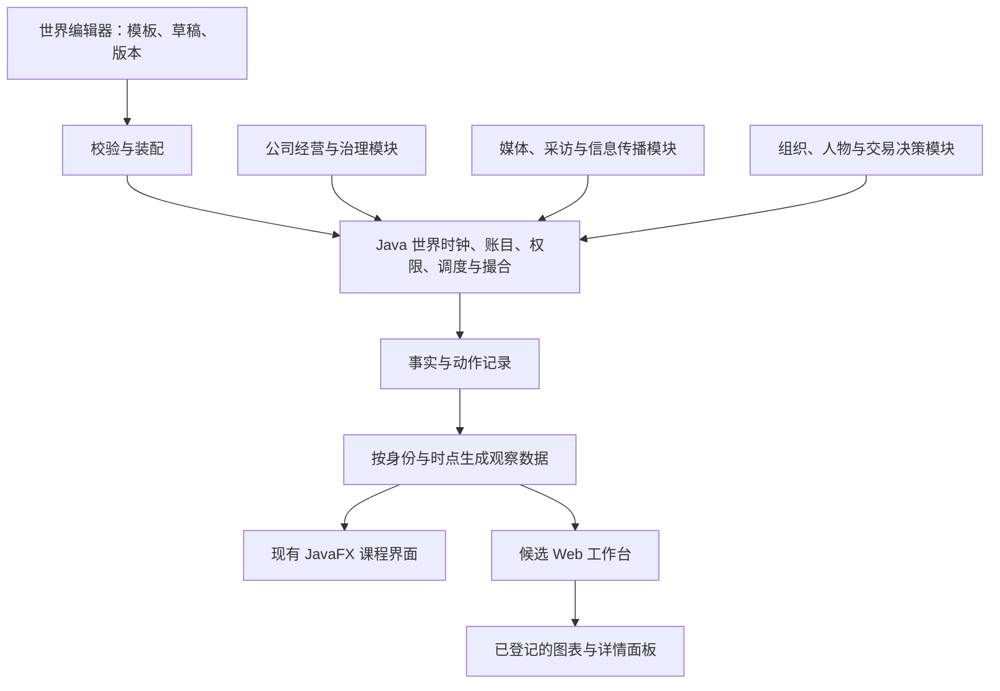

# 观察界面与可插拔世界：产品研究及设计建议

> 2026-11-05 统一入口：本文保留专题依据和设计演进；跨模块规则、冲突处置及实施门槛以[总体设计基线](../design/总体设计基线.md)为准。本文中的草案、原型和计划不代表功能已实现。

日期：2026-11-05。性质：供用户返回后审阅的设计稿与可丢弃交互草图，不是已批准的实施规格。

本轮依据：用户明确要求继续设计，重点为 K 线／日线、上帝视角、打开单个 Agent 账户、清晰而完整的信息入口，以及公司、媒体、交易 Agent、界面模块的创建、复制和增删改。用户离开期间按合理假设继续工作，不以尚未回复视为接受新增架构选择。

## 1. 建议方向

采用“Java 世界与交易内核 + 可替换的观察界面 + 受校验的模块配置”。界面默认以日 K 为中心，详情按对象与任务展开；所有信息都有明确入口，不要求同时铺满主屏。

先提供两套布局草图：

- **行情中枢（推荐默认）**：左公司池，中间日 K 和成交量，右公司／信息详情，下方账户、任务、事件、仓位标签。
- **世界画布（上帝视角备选）**：上方公司概览和经营联系，中间仍保留大幅行情图；适合从环境和关系寻找观察对象，纵向空间需求更大。

两者使用同一种对象、时间、权限和事件规则，不应成为两套模拟系统。后续用户已选定白色并认可主布局；当前继续细化白色世界画布，新增股票、公司、账户、世界关系、人物机构与信息讨论独立页。名称“观澜”仍是草图暂用名。新的产品研究、银行约束和页面分工见《2026-11-05-虚拟银行约束与详情工作区设计.md》；本稿下文的双方案描述保留为早期研究记录。

可插拔的现实边界：新增既有类型的实例、改变配置、组合既有面板，应不修改撮合和其他业务模块；全新经营机制通常需要新增对应实现；改变共享概念或接口语义时仍需版本升级与迁移。不能保证任意未来需求都完全不改其他代码。

## 2. 从现有产品借鉴什么

本节只核查官方文档，没有登录这些产品进行交互测试。产品能力不等于本项目已经具备。

| 官方来源 | 文档确认的机制 | 本项目建议 |
| --- | --- | --- |
| [TradingView：布局与图表](https://www.tradingview.com/support/solutions/43000692404-layouts-charts-drawings-indicators-and-their-interaction/) | 布局保存图表及设置，自选列表等并非布局内容 | 世界配置、运行状态、用户布局分别保存 |
| [TradingView：图表同步](https://www.tradingview.com/support/solutions/43000629992-how-to-sync-the-charts-of-my-layout/) | 标的、周期、十字线、时间和日期范围可分别同步，支持分组 | 同股日 K 与分时共享标的但保留周期；比较图可以固定另一只股票 |
| [TradingView：Bar Replay](https://www.tradingview.com/support/solutions/43000474024-how-do-i-turn-bar-replay-on/) | 历史起点、步进、速度及多图同步；该页说明普通 Paper Trading／券商订单及报价列表仍使用实时数据 | 借鉴播放器交互；本项目的账户、信息与决策必须一并回到历史时点。不能将该限制扩大解释成其所有回放交易功能均不可用 |
| [IBKR：Mosaic](https://www.ibkrguides.com/traderworkstation/mosaic-layout.htm) | Portfolio、Order Entry、Order Monitor 各司其职，窗口可组合并按组联动标的 | 持仓、目标仓位、母任务、已提交订单和成交分开；打开账户不自动取得操作权 |
| [IBKR：Monitor Panel](https://www.interactivebrokers.com/campus/trading-lessons/getting-started-with-monitor-panel/) | 自选与持仓标签、分组、列选择与筛选 | 默认少量关键列，其余展开；采用本项目现金与库存口径，不照抄其保证金字段 |
| [Grafana：Library panels](https://grafana.com/docs/grafana/latest/visualizations/dashboards/build-dashboards/manage-library-panels/) | 库面板被多个布局引用，修改传播到引用者，可解除关联 | “独立副本”与“共享引用”分开；编辑共享定义时显示影响范围 |
| [Grafana：插件类型](https://grafana.com/docs/grafana/latest/administration/plugin-management/plugin-types/) | 面板、数据源和应用插件具有不同职责 | 显示组件、观察数据与业务能力分别扩展，不用一个万能插件替代所有边界 |
| [Grafana：数据源权限](https://grafana.com/docs/grafana/latest/administration/data-source-management/#data-source-permissions) | 数据源查询权与面板显示并不相同；精细权限有版本边界 | 正式版在服务端裁剪数据，不能把全知数据发给普通角色再隐藏 |

未核验产品订阅价格；只确认了文档列出的部分订阅／版本限制。不建议为了使用某种布局直接迁入这些完整平台。

## 3. 页面组织与联动

### 3.1 三种工作状态

1. **观察运行**：默认只读，查看当前世界和历史。
2. **个人账户**：根据当前身份查看持仓、可用和冻结资源、订单、收益及收到的信息；只有获得交易授权的身份才有操作入口。
3. **编辑世界**：创建或复制模板、配置公司／媒体／角色、检查依赖和初始资源。编辑草稿不改变当前运行。

上帝视角可以打开任何被授权观察的账户，但“观察账户”与“接管决策”分开。接管或注入事件属于改变实验的动作，后续应显式记录操作者、原因和生效时间。当前草图只做观察，没有交易或接管入口。

### 3.2 固定在顶栏的上下文

世界／运行标识、世界时间、当前是实时还是回看、观察身份。账户选择与股票选择分别存在；选中另一只股票不能悄悄切换账户，打开其他账户不能悄悄改变交易授权。

默认联动：

| 用户动作 | 应联动 | 应保留 |
| --- | --- | --- |
| 选择公司 | K 线、盘口、该公司的披露／媒体报道、经营详情 | 世界时间、观察身份、选中账户 |
| 切换日 K／分时 | 柱体聚合和时间轴 | 世界进度、账户与信息可见截止点 |
| 选择历史时间 | 行情、账户、新闻、私聊、岗位决定的历史投影 | 当前运行继续前进的事实；回看本身不回滚世界 |
| 打开 Agent | 人物、所属组织、其可管理／可观察的账户 | 当前行情图；可明确选择是否跳转到其持仓股票 |
| 打开事件 | 原文／摘要、来源、时间、传播与相关决定 | 图表位置和当前身份 |
| 移除面板 | 当前布局 | 世界实体、后台状态、历史和其他人的布局 |

可固定比较面板：例如主图跟随选择，另一图始终观察电力公司；固定状态要明显显示。默认只展开一个右侧详情，避免同时堆积多个抽屉。

### 3.3 信息的主入口

- **市场**：日 K、分时、周 K、成交量、盘口、逐笔成交、市场概览。
- **公司**：经营过程、现金／债务／产能等适用指标、董事会评估、管理决定、已披露与未披露状态。
- **机构与人物**：组织与资金归属、角色职责、账户、目标与实际仓位、母子任务、输入证据及对外可记录的决策摘要。
- **信息**：公告、报道、更正、采访／电话、私聊、传播来源与收到时间。
- **世界编辑**：模板、实例、版本、依赖、待应用改动和布局管理。

全局搜索应覆盖当前身份有权知道的实体和记录。不可见信息不通过搜索建议、结果数量、导出、错误提示或缓存旁路泄露。

## 4. 图表设计及 K 线口径

### 4.1 图表用在合适的信息上

| 问题 | 默认图表／表示 | 展开后的核查材料 |
| --- | --- | --- |
| 价格怎样变化 | K 线 + 成交量，共享时间轴 | 对应成交、价量字段、数据截止点 |
| 为什么调整仓位 | 实际持仓条形图 + 目标位置标记 | 母任务、风控限制、逐笔执行 |
| 账户表现与风险 | 净值曲线、回撤曲线 | 资金流入流出、费用、估值价格与收益口径 |
| 公司经营是否兑现 | 订单／交付、收入／回款、现金消耗等适用时间序列 | 合同、计划、执行事件与披露 |
| 消息怎样扩散 | 按人物排列的传播时间线，必要时局部关系图 | 原始来源、转述、更正和接收记录 |
| 多公司是否有共同风险 | 按风险来源分组的敞口条形图，足够数据时再给相关性矩阵 | 持仓明细、估计窗口、样本量和未知部分 |
| 一个机构怎样决策 | 研究 → 配置 → 风控 → 执行的任务时间线 | 各角色提交的证据、理由摘要、权限和状态 |

不默认使用三维图、满屏关系网或大量仪表盘。关系图先展示选中对象一至两层邻居。趋势图必须有单位、时间范围和来源；未知、缺失、未披露与零分开。

不把所有内部推理文本当作展示物。保存并显示可审计的输入证据、结构化决定、简短理由、授权与执行结果，便于检查行为。

### 4.2 K 线是数据规则，不是换一种画法

当前界面是最新价折线，不是完整 OHLC K 线。正式版建议：

1. 使用真实成交事件生成 OHLC、成交量和成交额；报价刷新与撤单不计成交量。按已选交易日历、时区和世界时间分桶。
2. 同一桶内以明确的成交顺序确定开收盘，最高最低覆盖桶内实际成交。成交 ID 去重；同一事件重放不能增加成交量。
3. 日 K、周 K 由同一条成交事实链聚合；交易日、午间休市、集合竞价和跨日规则遵从选定制度，不能机械按墙钟每 24 小时滚动。
4. 未完成柱体标注截止时刻；回看日内时，只能用截至当时的成交计算当天最高最低，不能取完整日柱再隐藏未来横坐标。
5. 无成交与停牌展示空缺或明确的参考价占位。若为连续显示沿用前价，必须标为无成交、量为零，不能伪造成交柱。
6. 分红、拆并股等需要可追踪的公司行为。原始成交价格用于交易核算；复权展示另行计算。回放区分“按当时已知信息复权”和事后完整复权，避免未来事件进入历史观察。
7. 价格与金额在 Java 账目中保持 BigDecimal；前端用于绘制的浮点值不能回流记账。数量仍为 long，跨前端传输时避免大整数精度丢失。
8. 事件标记区分真实发生、公开披露、角色收到和采取行动的时间。图上相邻不等于已证明因果。

初期图表功能优先级：日 K／分时／周 K、量柱、十字线、缩放平移、时间范围、当前柱标记、事件开关；指标计算随后接入统一口径。不能以安装图表库代替行情聚合和数据核查。

### 4.3 图表与前端实现候选

- **推荐评估 Lightweight Charts 作为金融图表底座**：可以接自己的数据，支持扩展。官方项目注明 Apache 2.0 及 TradingView 署名／链接要求，实施时保留相应声明。[官方仓库](https://github.com/tradingview/lightweight-charts)
- 它不自带市场数据或完整指标系统，正式版需自己提供合成世界的行情及指标；TradingView 的托管 Widgets 不能接我们的自有数据。[官方产品区别](https://www.tradingview.com/charting-library-docs/latest/product-comparison/)
- Advanced Charts 有公开使用等条件，不能默认适合本地私有课程项目；需按部署方式另核许可。[官方说明](https://www.tradingview.com/charting-library-docs/latest/introduction/)
- 经营、风险和传播图可评估 Apache ECharts；官方支持折线、柱、K 线、热力和关系等多类图及交互。[官方功能](https://echarts.apache.org/en/feature.html)

本轮未安装这些库，草图用自包含绘图验证布局；未以草图性能推断生产图表承载能力。Context7 已定位 Lightweight Charts 官方文档库，但正文查询连接失败，具体能力以已读官方页面为据。

## 5. 可插拔世界的四层

箭头表示主要依赖和流转，不表示各模块可直接写入核心账目。模块提出命令或产出内容，由核心验证与执行；事实记录在执行成功后产生。

### 5.1 需要分开的对象

| 对象 | 职责 | 复制的含义 |
| --- | --- | --- |
| 能力实现 | 某种经营／媒体／决策／显示行为 | 开发新实现并登记，不从界面任意执行代码 |
| 模板 | 类型、默认参数、治理或行为配置 | 生成独立模板草稿；可明确保留共享引用 |
| 场景定义 | 实体清单、关系、初始资源与制度 | 创建新场景，不向运行中重复注入资产 |
| 运行实例 | 某次世界的实际状态、账户与历史 | 普通“复制”禁止复制运行资本；从检查点开分支是另外的实验操作 |
| 观察布局 | 面板、位置、固定对象与联动组 | 复制视图设置，不复制数据或权限 |

同一模板的更新不追溯改变既有运行。实例固定所用版本；升级需查看差异、依赖和迁移结果。共享模板的“升级全部引用”是显式动作，默认生成新版本。

### 5.2 模块可以扩展到哪里

| 模块 | 接收 | 产出 | 不应自行控制 |
| --- | --- | --- | --- |
| 公司 | 行业环境、合同、自身状态、岗位授权 | 经营计划、资源请求、执行结果、披露建议 | 任意改股价、交易者账户或已发生事实 |
| 媒体 | 可接触资料、联系人与采访反馈 | 调查任务、报道、更正、传播动作 | 读取全部世界秘密或替公司创造经营事实 |
| 机构／人物 | 角色可见信息、账户观察、任务与记忆 | 研究意见、配置意图、风控约束、授权订单 | 越权访问其他人的私密内容或直接改账 |
| 显示面板 | 经过权限与时间裁剪的观察数据 | 显示、筛选、选中对象；授权操作请求 | 修改世界状态、扩大观察权限 |

先用少量有类型的接口和注册表装配，不引入任意第三方 JAR 热加载、插件市场、跨服务分布式事务或统一的万能 JSON 执行器。若未来确需不可信插件，隔离、资源限制和权限需另立设计。

### 5.3 什么改动需要动代码

| 新需求 | 预期改动范围 |
| --- | --- |
| 再建一家已有经营类型的公司 | 配置新实例与初始资源，不改撮合 |
| 增加媒体、调整采访偏好或发布频率 | 已有行为范围内修改配置 |
| 增加某机构研究员 | 添加身份、职责与预算，不另造一份基金资产 |
| 新增现有指标的图表面板 | 新面板登记／布局配置，复用观察查询 |
| 新增银行经营或完全不同的媒体调查动作 | 新业务实现，满足既有契约；如现有契约表达不了则升级该边界 |
| 改订单类型、结算制度或增加新的权限语义 | 需要修改相关核心契约、调用方和验证，不能承诺零影响 |

## 6. 增删改的生命周期

默认首阶段支持开局前编辑、复制、校验和创建运行。运行中显示面板可以即时增删；世界实体与业务配置先在暂停的安全点应用，具体能力逐类开放。此方案避免把“可插拔”误等同于“所有东西都能随时热替换”。

| 操作 | 提议规则 |
| --- | --- |
| 新增公司 | 校验类型、初始资本、股份归属、债务及关联；新上市和单纯新增非上市公司分开。开局后新增不能凭空增发可交易财富 |
| 复制公司／交易者 | 复制配置、生成新 ID；默认不复制现金、持仓、冻结、订单、私人经历和社交关系。关系需重新确认映射 |
| 修改参数 | 生成差异草稿，标注适用实例、版本和生效点。旧 LLM 任务的结果需与当前版本复核 |
| 停用交易角色 | 先阻止其新任务和新提交，再处理在途回答、调度与有权撤销的挂单；账户仍可被其他有效角色管理 |
| 停用公司 | 不自动消灭债务、合同、股票和投资者持仓。停止经营、停牌、退市、清算是不同状态 |
| 停用媒体 | 停止新增采访／发布任务，处理未完成任务；历史文章、更正和来源仍保留 |
| 删除实体 | 未运行且未被引用的草稿可删除；参与过运行的实体归档保留 ID 与历史引用 |
| 移除显示面板 | 立即改变布局，不停用数据源或业务实体 |
| 更换能力版本 | 验证依赖和状态迁移；失败时原实例继续有效或维持明确的暂停状态，不留下半应用状态 |

人物、机构账户、订单执行任务具有不同归属。停用一个研究员不应撤销整个基金的有效订单；撤单必须检查任务与订单授权，不能只依据账户名称猜归属。

## 7. 接口契约的设计边界

本节是待实现语义，不是已上线 HTTP 路由。第一阶段可保留 Java 进程内接口；Web 接入确定后再将需要的边界转成版本化服务契约，避免先设计大量空端点。

### 7.1 观察契约

请求围绕运行、对象、账户、时间截止点、分页和所需视图。身份及权限由可信会话／任务授权得到，客户端传入的角色名称不能自行授予上帝权限。

返回包含：对象 ID、快照版本、世界时间、不透明快照标识、数据可见范围、来源／新鲜度和具体视图数据。全局事件截止序号由服务端维护，仅向有审计权限的上帝视角提供；普通角色不通过序号差推测隐藏活动。账户估值应使用同一截止点的全组合价格；缺失或陈旧价格要标注，不能默默用成本价冒充最新盯市值。

所有可联动面板共享同一快照标识，对应服务端同一截止点。缓存键包含运行、身份／授权、时间和查询范围，避免先访问上帝视角后把缓存给普通角色。导出使用同样裁剪规则。角色变更或授权失效后，旧快照标识与订阅游标不能继续扩大访问。

### 7.2 行情与事件契约

行情查询需要标的、周期、交易日历、时间范围和快照标识，由服务端解析截止序号，结果说明原始／复权、完整／未完整、缺失或无成交状态。精确金额用十进制字符串表达；数量和 ID 的传输表示须保证 Java long 可无损往返。

后台事件记录区分：唯一 ID、运行 ID、全局审计序号、事件类型／版本、关联实体、发生时间、公开时间、接收者可用时间、来源和受众。某些时间可尚未发生而为空；不得把未来预定披露时间误作已经可见。命令因果关联帮助追踪过程，但不自动证明金融因果。对普通观察者投影时裁剪审计字段，只保留其可见的引用和记录。

公开逐笔成交不携带所有账户真实身份；本人回报、机构内部记录、上帝审计记录分层提供。禁止将私密消息直接放入现有全体行情广播。

若后续使用推送，采用该观察者可见订阅流的连续投递序号或不透明游标来补取；它与全局审计序号分开。合法过滤掉的私密事件不会被误判为丢包，也不通过缺号暴露活动数量。重复事件不重复记账／绘图。前端在锁外合并重绘，慢面板或断线不能阻塞撮合或改变仿真结果。具体刷新频率依据实测确定。

### 7.3 变更契约

修改场景或运行的命令需要明确目标版本、动作、参数和生效点；重要命令带去重标识。结果至少区分已接受、等待安全点、成功、拒绝／冲突，不能以请求已接收显示修改已完成。

权限不足、版本冲突、依赖缺失、在途任务、资源不足和不支持的运行时变更应返回可解释原因。界面可以重试读取；重复提交变更不能再创建一份实体或重复发放资源。

扩展字段兼容旧读者；改变既有字段语义不能静默执行。新模块声明自身版本、所需能力和支持的配置版本；已有模块消费公开契约，不依赖其他模块私有类。

### 7.4 回看与分支

回看是读取历史投影；继续当前运行、从检查点开新分支是另外的操作。分支生成新运行 ID 和自己的输出目录，沿用检查点资源是新实验的初始状态，不是向原世界复制资产。

需要保存影响行为的实际输入、决定、随机结果及关键状态，才可能回放。固定种子不能保证再次调用 LLM 得到同样结果。当前 CSV 不含完整公司、媒体、记忆和角色状态，不能宣称已有完整世界回放能力。

### 7.5 世界时间与模型等待（本轮提议，待收敛）

初期建议优先采用可审计的实验时间：世界按有序事件推进，角色在观察时间 T 读取固定快照；调查、思考和执行的模拟耗时由动作规则确定，产生不早于 T 的计划行动时点。实际 API 响应快慢不直接决定谁在世界中先抢到订单。

模型调用可并行；世界可以推进至下一个需要该决定的计划行动点。若回答尚未返回，仿真进度停在该点等待，界面仍可查看并显示等待状态，不冻结桌面。达到单独设定的墙钟等待上限则记录超时，采用已明确的观望／规则回退；不能无记录地跳过。等待上限和动作模拟耗时必须分别配置并报告，未在本轮任意锁定数值。

回答到达后，在行动生效点重新检查角色状态、任务版本、授权、资金与订单约束；过期或停用角色的回答作废。它不能自动获得等待期间新发生的私密信息；需要重新研究时产生新观察与新任务。同一时刻的动作采用明确并记录的排序规则，不能按网络返回先后排序。

这种模式适合先核查因果与回放，运行耗时仍受真实模型延迟影响。若未来需要墙钟实时竞技，应另选截止和迟到处理规则，并承认服务延迟会影响行为。该选择要在生产调度实现前确认，不以播放倍速控件掩盖不同语义。

## 8. 与当前 Java 项目的衔接

本节为静态源码检查，未运行现有仿真，未修改其文件。当前用户已有的 PROJECT_MEMORY.md 和 config.properties 改动保持原样。

| 证据位置 | 当前情况 | 对后续工作的影响 |
| --- | --- | --- |
| `MatchingEngine.java:51,78–84`；`Account.java:155,383–397` | 多标的订单簿与组合持仓已有基础 | 保留核心撮合与账户；不要为公司模块重写这一层 |
| `TradingAgent.java:11–12`；`AbstractTradingAgent.java:39` | Agent ID 与账户 ID 绑定 | 机构四岗位需先分身份与资金归属 |
| `SimulationRunner.java:60,149–163`；`AgentType.java:4` | 固定装配和调度，类型仍主要是 HUMAN／AI／NOISE | 拆出场景装配与模块登记；控制方式不能当完整身份体系 |
| `AuctionUi.java:136–141,289–318` | UI 创建运行、固定第一个人工账户，价格图是 LineChart | 将观察与启动分开；K 线需要历史聚合层 |
| `AuctionUi.java:186–190,643–648,778` | 切股票清空图；成交列表缺少股票字段 | 历史按标的保存，界面选择不销毁历史；逐笔列表明确标的 |
| `PromptBuilder.java:61–62`；`Account.java:391–394` | 用单股价格表计算总权益，其他持仓回退成本价 | 增加完整组合观察，避免模型把部分盯市当全组合权益 |
| `MarketDataPublisher.java:56` | 同步广播公开行情 | 不在回调中执行 LLM；私密传播另走有权限的信息入口 |
| `MatchingEngine.java:367` | 交易时间当前使用真实时钟 | 董事会、财报、交易日和记忆需要统一世界时间 |
| `CsvHistoryRecorder.java:53–62` | 构造即截断输出 CSV | 预览配置不能创建 Runner；新运行有独立目录 |
| `SimulationRunner.java:258–262`；`AuctionUi.java:767–770` | close 停调度并关记录器，不等于 closeAndRank 的撤单流程 | 停用、暂停、正常关闭、紧急停止要分别定义；处理迟到回答 |

源码支持上述风险判断，但多股票总权益、退出与在途下单等仍需专门复现后再修复。没有将它们写成已完成修复。

实现路线比较：

- **继续只用 JavaFX**：变更面较小，课程交付直接；复杂图表、布局和插件展示需要较多前端工作。
- **Java 核心 + Web 工作台（推荐继续验证）**：金融图表和多面板更容易组合；需要明确观察接口、鉴权和推送。现有 JavaFX 课程交付保留，不在本轮擅自删除。
- **全面插件框架／微服务拆分**：隔离能力更强，但部署、版本和状态一致性成本较高，当前证据不足以支持首版采用。

JavaFX 内嵌 WebView 只是待评估候选，尚未验证现代图表兼容性，不能承诺可直接包装上线。也未决定维护两套完整、功能相同的前端；需结合课程验收与后续主界面选择确定。

## 9. 分阶段实现与验收建议

| 阶段 | 交付 | 验证重点 |
| --- | --- | --- |
| 设计收敛 | 布局、权限矩阵、对象与生命周期、图表口径 | 用户审阅草图；新需求能找到明确入口 |
| 观察基础 | 世界时钟、逐标的成交历史、组合快照、只读视图 | OHLC 复算、跨日／休市／无成交、价格缺失和完整组合估值 |
| 身份与信息 | 机构账户与岗位、信息接收与披露 | 普通角色不能取得全知数据；导出和回放同样受限 |
| 场景编辑 | 模板、复制、配置校验、独立运行目录 | 复制不重复发放资源；预览不覆盖旧输出；引用与版本明确 |
| 扩展与运行变更 | 新业务实现、受控停用、面板登记 | 不改撮合即可加同类实例；停用后迟到回答不能提交；历史保留 |
| 界面联调 | 真实 K 线、账户、事件和组织视图 | 选中、联动、回看一致；断线／慢面板不改变市场结果 |

数据权限、资金和订单不是低风险 UI 调整，实施时需要有意义的回归检查。阶段完成仍按仓库要求走 PR、人工 review、评分表状态更新与真实验证记录；本轮研究与草图不冒充阶段验收。

## 10. 本轮草图与验证边界

可丢弃草图保存在当前聊天的可持久化产物目录：

`C:/Users/JXGU/.codex/visualizations/2026/11/05/01a1aaf1-8e48-7ee3-8af8-7ce108d82259/stock-world-sketches/`

- `index.html`：两种方向的比较入口。
- `terminal/index.html`：行情中枢。
- `atlas/index.html`：世界画布。
- 每种方向有 README 和实际浏览器截图。

独立 HTML 无外部依赖，刷新恢复初始样例。当前实现了公司／周期／日期／视角切换、账户与岗位展开、事件详情、模块草稿的创建复制编辑移除，以及辅助面板隐藏恢复。未实现真正的任意布局拖拽、金融图表全部交互、后台接口、权限系统、模块装载或真实世界回放。

行情数据是固定种子合成样例；分时、日 K、周 K 取自同组样例聚合。账户和经营字段是独立展示数据，不是由这些成交结算得到。不得用图中的收益、相关性或公司表现作实验结果。

实际检查记录：

- 两种草图均在本机浏览器打开，检查默认桌面布局并保存完整页面截图；查看了 K 线、成交量、事件和账户布局，没有观察到重叠或缺失绘图。未完成手机／多种屏幕尺寸验收。
- 验证打开机构账户、切换到风控岗位；个人账户改为个人记录，不再显示机构四岗位。
- 验证分时、日 K、周 K 切换；回到首日时行情和信息记录一起回到早期状态。此验证只覆盖合成草图，不证明后端世界回放正确。
- 验证个人视角只展示本人账户和可见信息；不属于青禾机构的角色在任务出现前后均显示同一空态，不泄露隐藏任务出现时间。这是显示行为检查，不是服务端安全测试。
- 验证复制公司后出现第 11 个配置草稿，创建媒体后出现第 4 个媒体草稿；验证辅助面板隐藏和恢复。未对所有编辑／删除路径作穷尽测试。
- 独立静态审阅发现并修正：全局审计序号与可见流游标混用、模型等待语义缺失、公司事件错误关联、任务占位行泄露存在性。末次修订将公司公告绑定对应公司，仅共同市场报道跨公司显示。
- 两份页面的内联 JavaScript 语法检查通过；浏览器检查期间未捕获页面错误；无外部脚本依赖。仓库 `git diff --check` 通过。没有运行 Java 测试、LLM 或现有仿真，没有安装生产依赖。

后续用户已选择白色并认可主布局，同时接受少量银行直接贷款与背景组合。前端部署方式、十家公司是否全部进入首版，以及具体银行和机构规则仍待细化。最新详情页与实际核查范围见《2026-11-05-虚拟银行约束与详情工作区设计.md》。
